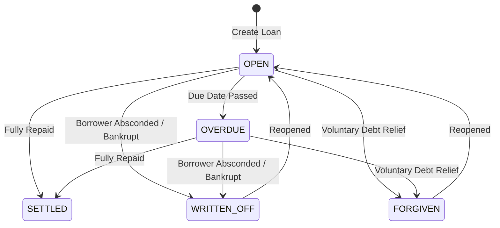

# CheyNgar (အချေးအငှား) - Mobile App

**Smart Lending, Borrowing, and Financial Ledger Management for Myanmar & Global Informal Credit Markets.**

---

## 📝 1. Core Concept & Dual-Identity

CheyNgar provides a digital ledger tailored for informal credit, micro-lending, and personal loan tracking:

- **Dual-Identity Architecture**:  
  Seamlessly switch between two operational modes in a single application:
  - **Lend (ချေးပေးထားငွေ / အကြွေးရှင်)**: Track money lent out, interest earnings, upcoming dues, and debtor profiles.
  - **Borrow (ချေးယူထားငွေ / ချေးသူ)**: Track money borrowed, interest payments, liabilities, and creditor profiles.
- **Stand-alone Ledger Approach**:  
  Independent accounting records maintained with full privacy and zero forced mutual-app dependency.
- **Primary Mission**:  
  Eliminate "memory-based" credit disputes with clear payment trails, accurate interest amortization, and double-entry financial reporting.

---

## 🔄 2. Complete Loan Lifecycle & Statuses

Transactions transition through 5 core lifecycle statuses:



| Status | Display (MM) | Description | Accounting Impact |
| :--- | :--- | :--- | :--- |
| **`OPEN`** | ဖွင့်ထားဆဲ | Active debt accruing interest | Counted in Active Lending/Borrowing |
| **`SETTLED`** | ရှင်းပြီး | Fully paid off ($0$ remaining principal) | Closed; interest stops |
| **`OVERDUE`** | ရက်လွန် | Passed the agreed due date without full settlement | Active; interest continues |
| **`WRITTEN_OFF`** | ကြွေးဆုံး | Debtor died, ran away, or defaulted | Moved to **Bad Debt Expense** (Loss); interest freezes |
| **`FORGIVEN`** | လျှော်ပေးသည် | Voluntary cancellation of debt (compassion/merit) | Moved to **Debt Forgiveness Expense**; interest freezes |

> **Note**: For both `WRITTEN_OFF` and `FORGIVEN`, users can record an optional **Closure Reason** (e.g., "Deceased", "Absconded", "Hardship relief"), and the app prevents further interest accrual or repayment entries.

---

## 🛡️ 3. Guarantor (အာမခံသူ) & Collateral (အပေါင်ပစ္စည်း) Tracking

To reduce lending risks, transactions support optional security instruments:

1. **Guarantor (အာမခံသူ)**:
   - Linked directly to existing **Contacts** via a contact picker.
   - Preserves Guarantor's Name, Phone Number, NRC, and Address without redundant data entry.
2. **Collateral (အပေါင်ပစ္စည်း)**:
   - Field for item description (e.g., Gold, Motorbike, Land Grant, Smartphone).
   - Optional estimated valuation in MMK.

---

## 💧 4. The "Waterfall" Repayment Logic

To follow standard credit norms and ensure accurate interest settlement:

1. **Accrue Interest First**:  
   Calculated from the `lastInterestCalcDate` to the repayment date.
2. **Deduction Priority**:
   - **Priority 1 (Interest)**: Applied against accrued interest.
   - **Priority 2 (Principal)**: Any remaining amount is deducted from the `remainingPrincipal`.
3. **Waterfall Outcome**:  
   Ensures that subsequent interest calculations are applied against the accurate net remaining principal.

### Interest Calculation Formula
$$\text{Accrued Interest} = \text{Remaining Principal} \times \left(\frac{\text{Interest Rate}}{100}\right) \times \left(\frac{\text{Days Elapsed}}{30}\right)$$

---

## 📊 5. Double-Entry Accounting & Journal Ledger (စာရင်းကိုင်နှင့် ဂျာနယ်)

Accessible from the Home Dashboard and Drawer Navigation, the **Accounting Module** provides a 2-tab view:

### Tab 1: Financial Summary (ဘဏ္ဍာရေး အနှစ်ချုပ်)
- **Trial Balance Health**: Live indicator validating that Total Debits ($Dr$) match Total Credits ($Cr$).
- **Profit & Loss (P&L)**:
  $$\text{Net P&L} = \text{Interest Income} - (\text{Interest Expense} + \text{Bad Debt Loss} + \text{Forgiven Debt})$$
- **Chart of Accounts**: Visual balances for Cash/Bank (`1000`), Loans Receivable (`1100`), Loans Payable (`2000`), Interest Income (`4000`), Interest Expense (`5000`), and Losses (`5100`/`5200`).

### Tab 2: Debit/Credit Journal (ဒက်ဘစ်/ခရက်ဒစ် ဂျာနယ်)
- Detailed journal feed with color-coded **Debit (Dr)** and **Credit (Cr)** badges.
- Filter chips: *All, Loan Disbursements, Loan Receipts, Repayments Received, Repayments Made, Write-Offs, Debt Forgiveness*.

---

## 👥 6. Contact Management & Bulk Import

- **Centralized Contact Book**: Unified database of borrowers, lenders, and guarantors.
- **Google & CSV Batch Import**: Easily import contacts from Google or CSV files with smart duplicate detection and merge options.
- **National Verification (NRC & Address)**: Store Myanmar NRC format and address details for legal clarity.

---

## ⚡ 7. Quick Calculator (အတိုးတွက်စက်)

Built-in standalone interest simulator allowing users to calculate projected daily, monthly, and total interest returns before issuing loans.

---

## 📁 8. Project Structure (lib/)

```
lib/
├── app.dart                          # Home dashboard with report cards
├── bloc/                             # BLoC state management
│   ├── accounting/                   # Double-entry ledger & financial reports
│   ├── auth/                         # User registration & PIN authentication
│   ├── contacts/                     # Contact listing & imports
│   ├── transaction_detail/           # Status transitions & repayment actions
│   └── transactions/                 # Loan listing & creation
├── core/                             # Routing, extensions, and network utilities
├── models/                           # Immutable data models
│   ├── accounting_entry.dart         # JournalEntry, JournalItem, FinancialSummary
│   ├── contact.dart                  # Contact entity with NRC & address
│   ├── repayment.dart                # Repayment entity
│   └── transactions.dart             # Transaction entity with status & collateral
├── repositories/                     # API repositories
├── services/                         # Background & platform services
│   ├── contacts_sync_service.dart    # Device contacts sync
│   ├── email_service.dart            # Email notifications
│   └── receipt_pdf_service.dart      # PDF receipt voucher generation & POS printing
├── ui/
│   ├── screens/                      # UI Screens (Accounting, Details, Create, Receipts)
│   └── widgets/                      # Reusable form fields, dialogs, and cards
└── main.dart                         # App initialization & MultiBlocProvider
```

---

## 🧾 9. Repayment Record Voucher & POS Printing ("ပြေစာသိမ်းမည်")

To ensure transparency, accountability, and seamless communication between lenders and borrowers, CheyNgar includes a minimalist repayment receipt voucher system:

### Key Highlights:
1. **Automatic Voucher Presentation**:
   - Immediately upon submitting a successful repayment in `RepaymentCreateScreen`, the app automatically navigates to the **Repayment Receipt Voucher** screen (`RepaymentReceiptScreen`).
2. **Dual Printing Formats & Font Rendering**:
   - **Flawless Printed Typography**: Uses `ZAWGYI-ONE_V3.1.TTF` powered by a built-in Rabbit converter (`Rabbit.uni2zg`) for physical printing and PDF export, ensuring zero broken vowels, misplaced medials, or un-shaped glyphs on thermal and standard printers. The app UI retains pure Unicode (`Pyidaungsu`).
   - **CheyNgar Brand Logo**: Embedded directly in the voucher header on both mobile preview and printed copies.
   - **Compact Thermal Margins**: Margins and vertical spacing are tightly configured (50% reduction in white space) to save continuous paper on cheap 80mm/58mm portable POS thermal printers.
   - **Standard A4 Sheet**: Neatly centered, compact voucher card suitable for home and office printers.
3. **Save to Downloads & Direct File Sharing**:
   - 🖨️ **Print Voucher**: Direct wireless or USB printing via standard OS print dialog.
   - 💾 **Save to Visible Downloads**: Directly saves `.pdf` files into the device's public **Downloads** directory (`/storage/emulated/0/Download` on Android or user Downloads on Desktop) for instant access.
   - 📤 **Direct File Sharing**: Shares the generated `.pdf` file directly to messaging and social platforms (Telegram, Viber, WhatsApp, Messenger, Gmail) without dumping text.
   - 📋 **Quick Text Copy**: Dedicated AppBar copy action for instant clipboard text copying when sending via SMS.
4. **Voucher History from Transaction Details**:
   - In `TransactionDetailScreen`, each repayment record is displayed as a clean minimalist card with strict overflow guards (`Expanded`, `maxLines: 1`, and `TextOverflow.ellipsis`).
   - Tapping any repayment record immediately opens its official printable/shareable voucher.

